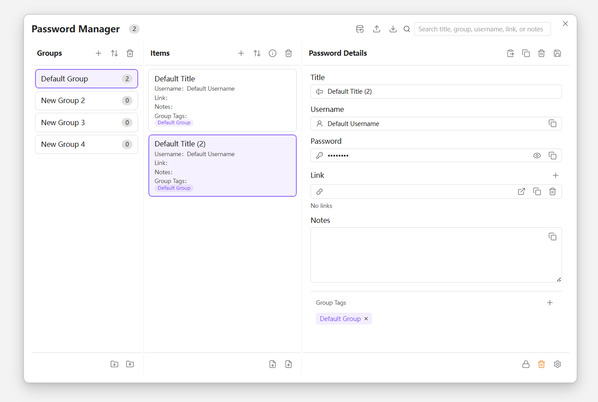

# Obsidian Password Manager Android

[中文文档](./README.zh-CN.md)

> Lightweight account, password, and link management inside Obsidian — with encryption, backup, recycle bin, and import/export support on desktop and Android.



## 📖 Introduction

**Obsidian Password Manager Android** is a lightweight password management plugin for Obsidian, designed for storing and organizing daily-use credentials directly inside your vault.

It uses a JSON-based data structure and provides a three-column management interface that allows quick switching between groups, entries, and details. For common scenarios such as website accounts, software logins, and simple key records, this approach is lighter and easier to manage alongside your notes.

## ✨ Features

- 🔐 **Encrypted storage** – Supports local encryption of the entire password vault. Unlock method and re-verification timing are configurable.
- 📱 **Desktop and Android** – Uses the same encrypted storage format on Windows and Android, so a vault synchronized between them can be unlocked with the same encryption password.
- 📂 **Group management** – Create custom groups (default, website keys, personal profiles, etc.) for easy classification.
- 🔍 **Quick search** – Real-time search by title, username, link, note, or group name.
- 💾 **Backup & restore** – Export all data as a one-click JSON snapshot and restore anytime.
- 📝 **Auto-export to Markdown** – Automatically sync and export the complete password vault to a specified Markdown file, convenient for read-only access, review, or integration into your note-taking workflow.
- 📤 **Import / Export** – Supports Markdown / JSON formats for migration or collaboration with other tools.
- 🗑️ **Recycle bin** – Deleted entries are temporarily stored in the recycle bin and can be restored or permanently removed.

## 🚀 Installation

### Manual installation (BRAT)

1. Install the [BRAT](https://github.com/TfTHacker/obsidian-brat) plugin.
2. Add `https://github.com/TingHua1/obsidian-password-manager-Android` in BRAT settings.
3. Enable the plugin.

### Local manual installation

- Download the latest `main.js`, `manifest.json`, and `styles.css` into your vault's `.obsidian/plugins/password-manager-android/` folder.
- Restart Obsidian and enable the plugin.

## 🔒 Security Notes

- This plugin **does not** transmit any data over the network; all information remains within your local Obsidian Vault.
- The current encryption implementation is based on the browser's native Web Crypto API: **PBKDF2 with SHA-256** is used to derive a key from the user-supplied encryption password, with **250,000** iterations; the actual data is encrypted using **AES-GCM 256-bit**, with a unique `salt` and `iv` generated for each encryption operation.
- When encryption is enabled, the plugin encrypts the entire password vault (`data.json`) for storage; password verification is performed via a separate verifier ciphertext, without storing the plaintext password in a reversible form.
- The V1 encrypted format is shared by Windows and Android. It keeps the same UTF-8 password encoding, PBKDF2-SHA-256 parameters, AES-GCM format, and Base64 encoding, so existing encrypted libraries and password verifiers remain decryptable across both platforms.
- Android does not provide the desktop-only **Open storage folder** action. The encrypted library, backups, import, and export continue to use the vault adapter.
- If you use Git to sync your vault, make sure `.gitignore` excludes any encryption key files (if present), or be aware that the ciphertext inside the JSON files will be committed.

> If you need more comprehensive professional password management capabilities, this plugin is better suited as a lightweight recording tool rather than a full replacement for dedicated password managers.

## 📝 Development & Contribution

- Repository: [https://github.com/TingHua1/obsidian-password-manager-Android](https://github.com/TingHua1/obsidian-password-manager-Android)
- Issues, PRs, and suggestions are welcome.
- Local development:

```bash
git clone ...
npm install
npm run dev
```

## 👏 Acknowledgments

This project is based on the original [Obsidian Password Manager](https://github.com/PandaNocturne/obsidian-password-manager) by [PandaNocturne](https://github.com/PandaNocturne).

It adds Android compatibility while preserving the original cross-platform encrypted data format.

## 📄 License

[MIT](LICENSE)
